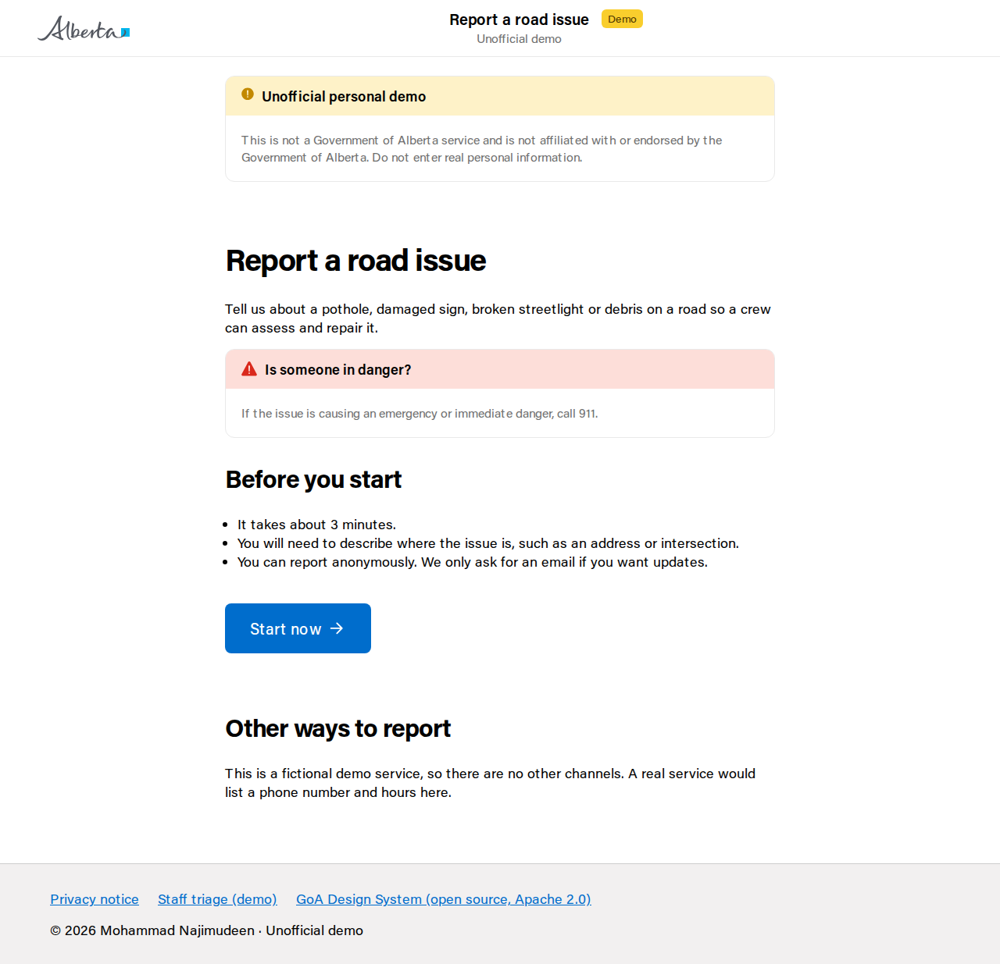
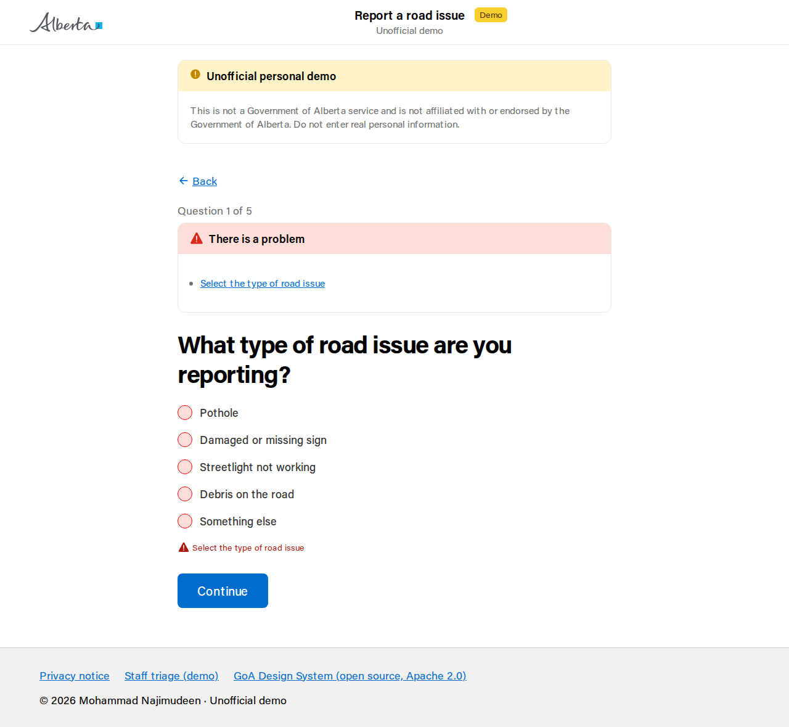
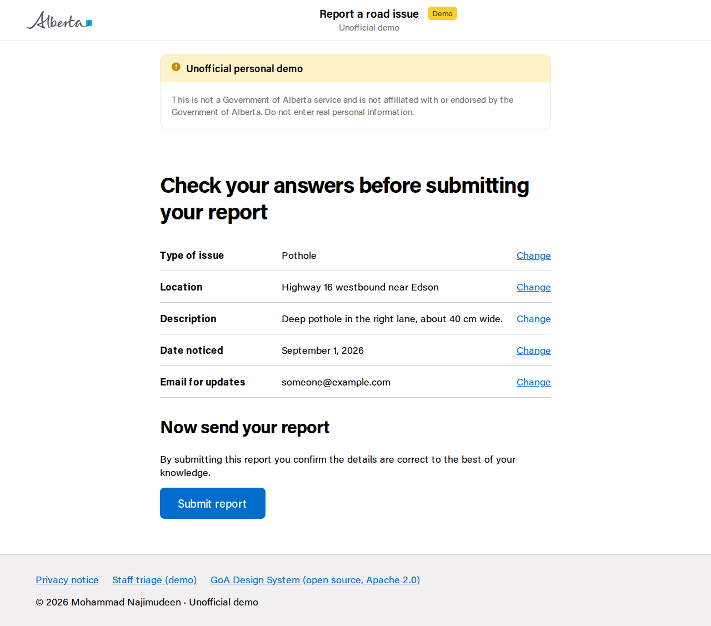
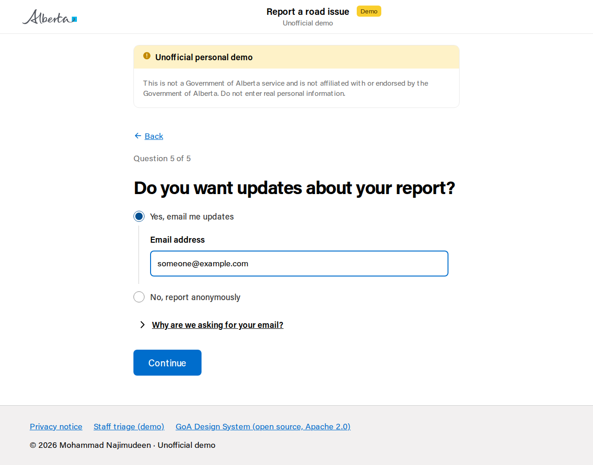
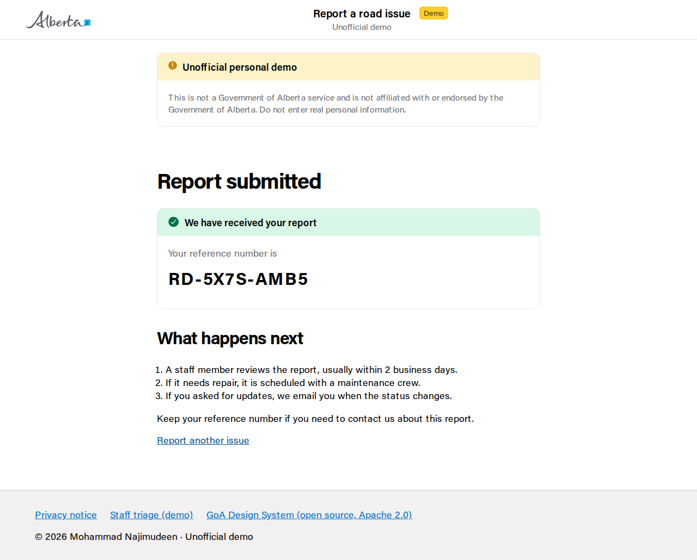
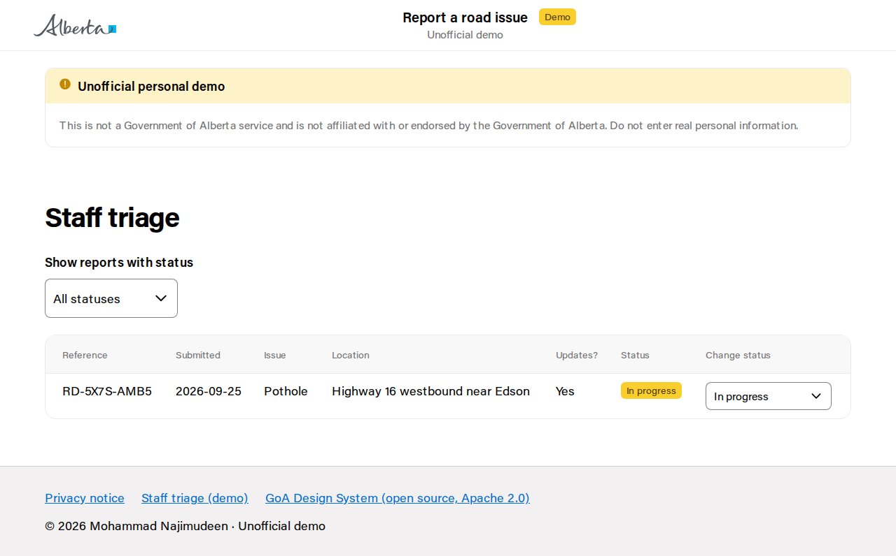
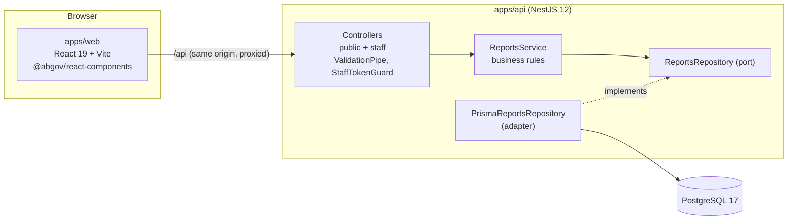

# Report a road issue — GoA Design System demo

> **Unofficial personal demo — not affiliated with or endorsed by the Government of Alberta.**
> It uses the GoA Design System's open-source components
> ([GovAlta/ui-components](https://github.com/GovAlta/ui-components), Apache 2.0) under their
> licence. It is not a real service: do not enter real personal information.

A small, complete, citizen-facing digital service built the way the Government of Alberta's
[Digital Design and Delivery](https://design.alberta.ca) guidance describes: a public form that asks
one question per page, lets people check their answers, and gives them a reference number, plus a
simple staff view to triage what comes in.

I built it to show hands-on experience with the **GoA Design System**
(`@abgov/react-components`, `@abgov/web-components`, `@abgov/design-tokens`) and a professionally
engineered **React + NestJS + PostgreSQL** stack, with automated tests (including accessibility) and CI.

| Start page                                   | Question page with error summary                              | Check your answers                                      |
| -------------------------------------------- | ------------------------------------------------------------- | ------------------------------------------------------- |
|  |  |  |

| Reveal pattern (optional email)                                      | Result page                                           | Staff triage                                          |
| -------------------------------------------------------------------- | ----------------------------------------------------- | ----------------------------------------------------- |
|  |  |  |

## What it does

**Citizens** (`/`): start page → 5 question pages (issue type, location, description, date noticed,
optional email for updates) → check your answers (with "Change" links) → confirmation with a
reference number such as `RD-7K3M-9QX2`.

**Staff** (`/staff`): enter a demo token, list reports, filter by status, and move a report through
`Received → In progress → Resolved` (the API enforces which transitions are allowed).

## Architecture



```
apps/
  api/                  NestJS REST API
    prisma/             schema.prisma + SQL migrations
    src/reports/        controllers, service, repository port + Prisma adapter, DTOs
    src/auth/           StaffTokenGuard (stand-in for SSO)
    test/               integration tests (supertest + real PostgreSQL)
  web/                  React app
    src/form/           answers, validation rules, step order, form state
    src/components/     layout, question page, error summary, back link
    src/pages/          start, questions, check answers, confirmation, staff, privacy
e2e/                    Playwright journeys + axe accessibility checks
docs/adr/               architecture decision records
docs/WALKTHROUGH.md     code tour and interview talking points
```

## Run it locally

Prerequisites: Node 24 (see `.nvmrc`), npm 11, Docker.

```bash
npm install                             # installs both workspaces, generates the Prisma client
cp apps/api/.env.example apps/api/.env
npm run db:up                           # PostgreSQL 17 in Docker (dev + test databases)
npm run db:migrate -w apps/api          # apply migrations to the dev database
npm run dev                             # API on :3000, web on http://localhost:5173
```

- Citizen journey: <http://localhost:5173>
- Staff view: <http://localhost:5173/staff> (token: `STAFF_API_TOKEN` from `apps/api/.env`)
- API docs (Swagger UI): <http://localhost:3000/api/docs>

## Test it

| Command                    | What runs                                                                                                     |
| -------------------------- | ------------------------------------------------------------------------------------------------------------- |
| `npm run lint`             | oxlint, warnings fail the build                                                                               |
| `npm run typecheck`        | `tsc` for api, web and e2e                                                                                    |
| `npm test`                 | Unit tests: API services, DTO validation, guard (Vitest); web validation and pages (Vitest + Testing Library) |
| `npm run test:integration` | Boots the real Nest app against PostgreSQL (`road_reports_test`) and drives it with supertest                 |
| `npm run e2e`              | Builds both apps, then Playwright runs the citizen + staff journey with axe checks on every page              |
| `npm run screenshots`      | Regenerates `docs/screenshots/`                                                                               |

First time only: `npx playwright install chromium`. The integration and e2e suites need the database
from `npm run db:up`.

CI (`.github/workflows/ci.yml`) runs all of the above on every push and pull request, using a
PostgreSQL service container.

## Design decisions

Short ADRs live in [`docs/adr/`](docs/adr):

1. [Monorepo with npm workspaces](docs/adr/0001-monorepo-npm-workspaces.md)
2. [Use the GoA Design System components](docs/adr/0002-goa-design-system.md)
3. [PostgreSQL with Prisma behind a repository port](docs/adr/0003-postgresql-prisma.md)
4. [Testing strategy](docs/adr/0004-testing-strategy.md)

Highlights:

- **GoA patterns, not just GoA components.** Start page, question page (one idea per page, back link,
  "Question X of Y"), review page with "Change" links whose hidden text names the question, and a
  result page with a success callout and reference number, following
  [design.alberta.ca/examples](https://design.alberta.ca/examples/).
- **Errors people can act on.** Validation runs on Continue, shows an error summary that takes focus
  and links to the field, and repeats the message on the field. The page title gets an `Error:`
  prefix. API validation messages are written in the same plain language and returned per field, so
  server-side errors display the same way.
- **Layered API.** Controllers handle HTTP, `ReportsService` holds the rules (future dates, status
  transitions, reference collisions), and a `ReportsRepository` port keeps Prisma out of the service,
  which makes the rules unit-testable with an in-memory fake.
- **Same config in tests and production.** `configureApp()` applies the validation pipe, helmet and
  Swagger for both `main.ts` and the integration tests.

## Accessibility (WCAG 2.2 AA minded)

- GoA components are built to WCAG 2.2; the app adds an `<h1>` per page that receives focus on
  navigation, unique page titles, a skip link, an error summary, and change links with hidden context.
- Every page in the e2e journey is checked with axe (WCAG 2.0/2.1/2.2 A and AA rules). This caught a
  colour-contrast bug in my own footer.
- **Findings in the component library.** axe reports a few issues inside `@abgov/web-components`
  2.5.0 that the app cannot fix. They are filtered narrowly (rule and location) in `e2e/helpers.ts`, so
  anything else still fails the build. I have not checked whether they are already reported upstream:
  - decorative `goa-icon` renders `role="img"` with an empty `aria-label`
  - `goa-date-picker` (`type="input"`): the visible Day/Year labels are not programmatically
    associated with their inputs
  - `goa-dropdown`: the popover trigger `<button>` wraps the combobox `<input>` (nested interactive)
  - `goa-notification`'s dismiss button has no accessible name (not used here any more)
- Automated checks find only part of the problems. A real release would also need keyboard-only and
  screen reader testing (NVDA/JAWS/VoiceOver) and usability testing with people.

## Privacy by design

Since June 11, 2025 Alberta public bodies follow the _Protection of Privacy Act_ (POPA), which
together with the _Access to Information Act_ replaced the FOIP Act. POPA sets rules for collecting,
using and disclosing personal information. This demo applies privacy-by-design ideas in that spirit;
it is not a legal compliance review:

- **Data minimisation:** no name, phone or address. Email is optional and only collected when the
  person asks for updates. An email typed before switching to "No" is not sent.
- **Need to know:** the staff list shows only whether updates were requested; the email is available
  only on the single-report endpoint.
- **No personal information in logs:** the API logs reference numbers only.
- **Short-lived client state:** answers in progress are kept in `sessionStorage` (this tab only) and
  cleared on submit.
- **Strict input:** unknown fields are rejected, not silently stored.
- A privacy notice page explains all of this. A real service would publish a formal collection
  notice and define a retention schedule (e.g. purge resolved reports after N months).

## Security notes

- Staff endpoints use a shared bearer token compared in constant time. This is a placeholder: a real
  GoA service would use SSO via Keycloak/OIDC (for example ADSP's access service) with roles.
- `helmet` sets security headers; the browser talks only to its own origin (`/api` is proxied), so no
  CORS is enabled.
- `npm audit` currently reports advisories in dependencies of the Prisma **CLI** (dev tooling only,
  not shipped in the API runtime).

## Not in scope (on purpose)

Save and return, file uploads, email sending, staff SSO, map-based location, pagination, i18n, and
deployment. On a real team these would come through discovery with designers and product owners.

## Licence

Apache 2.0 for this repository's code. The GoA Design System packages are © Government of Alberta
and licensed under Apache 2.0; they are used unmodified from npm.
